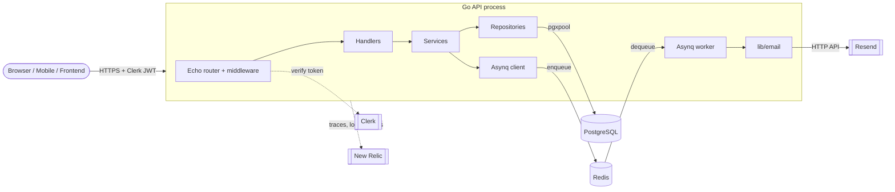
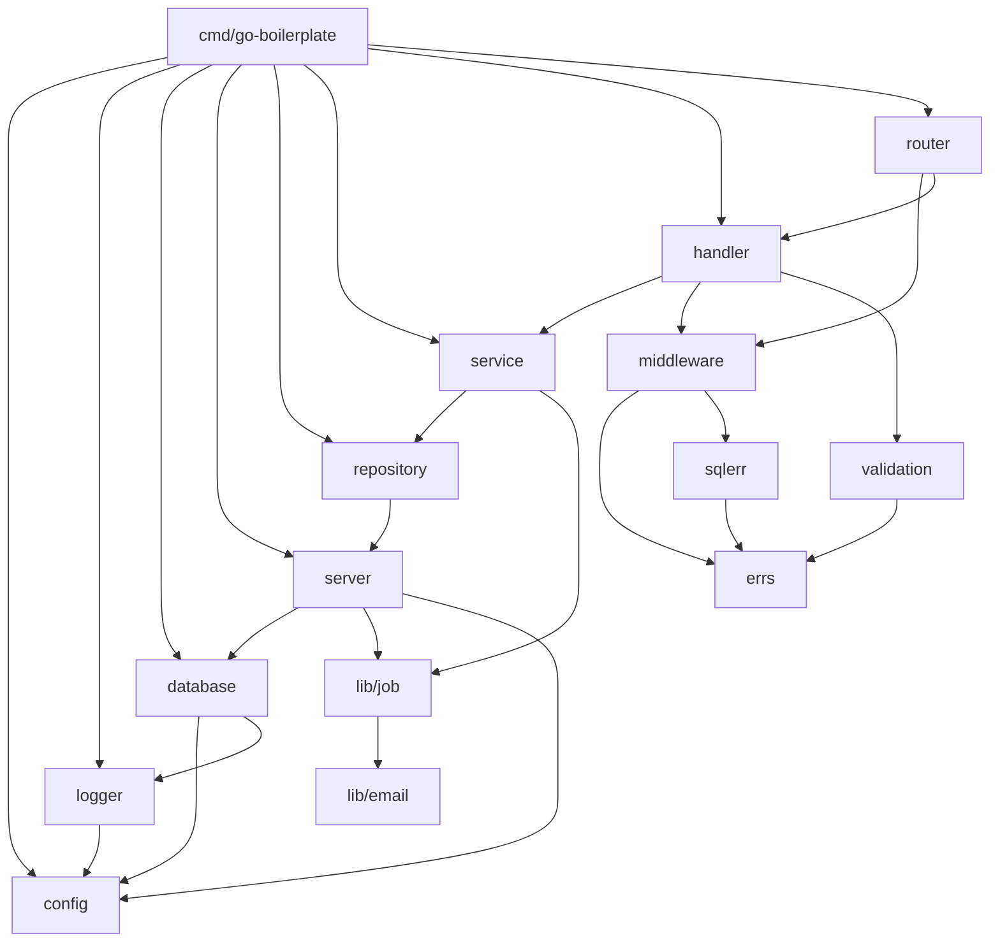

# 02 · Architecture diagram

GitHub renders these Mermaid diagrams automatically.

## Runtime components



## Package dependency graph (who imports whom)



Notice: arrows only go **downwards**. `errs`, `config` and `model` are leaves
that many packages depend on, and they depend on almost nothing.

## Layers as an onion

```
┌───────────────────────────────────────────────────────────┐
│  main.go  (composition root: builds and wires everything)  │
│ ┌───────────────────────────────────────────────────────┐ │
│ │  router + middleware   (HTTP concerns, cross-cutting)  │ │
│ │ ┌───────────────────────────────────────────────────┐ │ │
│ │ │  handler + validation   (HTTP ⇄ Go translation)    │ │ │
│ │ │ ┌───────────────────────────────────────────────┐ │ │ │
│ │ │ │  service   (business rules)                    │ │ │ │
│ │ │ │ ┌───────────────────────────────────────────┐ │ │ │ │
│ │ │ │ │  repository   (Go ⇄ SQL translation)       │ │ │ │ │
│ │ │ │ │ ┌───────────────────────────────────────┐ │ │ │ │ │
│ │ │ │ │ │  model   (plain data structs)          │ │ │ │ │ │
│ │ │ │ │ └───────────────────────────────────────┘ │ │ │ │ │
│ │ │ │ └───────────────────────────────────────────┘ │ │ │ │
│ │ │ └───────────────────────────────────────────────┘ │ │ │
│ │ └───────────────────────────────────────────────────┘ │ │
│ └───────────────────────────────────────────────────────┘ │
└───────────────────────────────────────────────────────────┘
   infra on the side: config · logger · database · server · lib · errs · sqlerr
```

---

Next: [03 · Startup flow](03-startup-flow.md)
