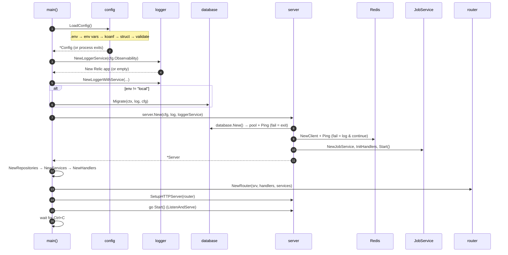

# 03 · Startup flow: from `go run` to "listening on :8080"



## Step-by-step with file references

| # | Step | File | Fails how? |
|---|------|------|-----------|
| 1 | `.env` loaded into the environment by a blank import `init()` | `internal/config/config.go` (`godotenv/autoload`) | silently skipped if no `.env` |
| 2 | Env vars → `Config` struct, validated | `internal/config/config.go` | **exit** with "config validation failed" |
| 3 | Observability defaults + `Validate()` | `internal/config/observability.go` | **exit** on bad log level |
| 4 | New Relic agent | `internal/logger/logger.go` | silently disabled if no key or init error |
| 5 | zerolog logger | `internal/logger/logger.go` | never fails |
| 6 | Migrations (non-local only) | `internal/database/migrator.go` | **exit** "failed to migrate database" |
| 7 | Postgres pool + ping | `internal/database/database.go` | **exit** "failed to initialize server" |
| 8 | Redis client + ping | `internal/server/server.go` | logs error, **continues** |
| 9 | Asynq worker started | `internal/lib/job/job.go` | keeps retrying Redis in background |
| 10 | Repos → services → handlers | `repository/`, `service/`, `handler/` | services can return error → exit |
| 11 | Clerk key set | `internal/service/auth.go` | never fails (bad key = 401s later) |
| 12 | Router + middleware | `internal/router/router.go` | never fails |
| 13 | `http.Server` with timeouts | `internal/server/server.go` | — |
| 14 | `ListenAndServe` in goroutine | `cmd/go-boilerplate/main.go` | **exit** if port is in use |

## Why this order?

- **Config first**: everything else needs it.
- **Logger second**: so every following step can log.
- **Migrations before the server**: never serve traffic with code that expects
  a column that doesn't exist yet.
- **Server (infra) before repos/services/handlers**: they all hold a pointer
  to it.
- **Router last**: it needs handlers to register routes.
- **Listen in a goroutine**: main must stay free to wait for the shutdown signal.

## Try it

```bash
cd apps/backend
cp .env.sample .env          # then fix DB password, Redis address, etc.
task migrations:up           # local env doesn't auto-migrate
task run
curl localhost:8080/status
```

---

Next: [04 · Request lifecycle](04-request-lifecycle.md)
