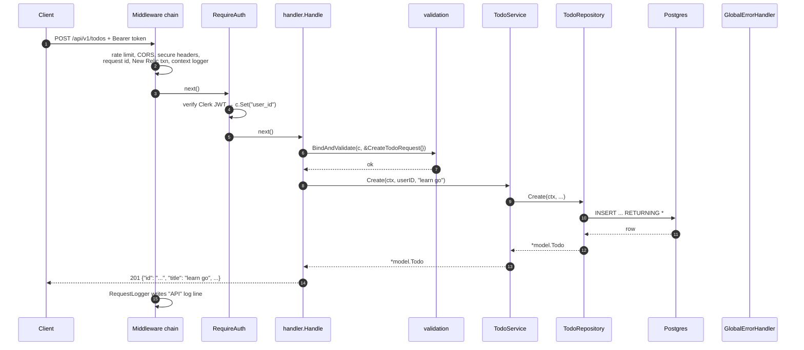

# 04 · The life of one HTTP request

We follow `POST /api/v1/todos` with body `{"title": "learn go"}` through the
system, assuming a Todo feature has been added (see [21](21-adding-a-feature.md)).



## Stage by stage

### 1. Network → Go
`net/http.Server` accepts the TCP connection (enforcing `ReadTimeout`), parses
the HTTP request and hands it to Echo.

### 2. Global middleware (outer layers)
| Middleware | Effect on this request |
|------------|------------------------|
| RateLimiter | IP's token bucket checked; over 20 req/s → **429** and stop |
| CORS | Adds `Access-Control-Allow-Origin` if origin allowed; answers pre-flight `OPTIONS` |
| Secure | Adds `X-XSS-Protection`, `X-Content-Type-Options`, `X-Frame-Options` |
| RequestID | `X-Request-ID: 4c90fc3f-…` generated, set on context and response |
| NewRelic | Starts a transaction named after the route |
| EnhanceTracing | Adds IP, user-agent, request id to the transaction |
| EnhanceContext | Creates `logger.With(request_id, method, path, ip, trace.id)`, stores in context |
| RequestLogger | Will log one summary line **after** everything returns |
| Recover | Will catch a panic and turn it into an error |

### 3. Route match + route middleware
Echo matches `POST /api/v1/todos`. The group has `RequireAuth`, so the Clerk SDK
validates the `Authorization: Bearer …` token. Missing or invalid → **401 JSON**
and stop. Valid → `user_id`, `user_role`, `permissions` set on context.

### 4. `handler.Handle` wrapper
- Logs `handling request`
- `BindAndValidate` → JSON into `CreateTodoRequest`, then `Validate()`.
  Problems → `*errs.HTTPError` 400 with field errors → returned up.
- Calls your handler function, timing it.

### 5. Service
Business rules (limits, ownership, state transitions), then calls the
repository with the **request context** (`c.Request().Context()`).

### 6. Repository → Postgres
Borrows a connection from `pgxpool`, runs a parameterised query, scans the row
into `model.Todo`, returns the connection to the pool. In `local` env the SQL is
printed to the console; with New Relic it appears as a DB segment in the trace.

### 7. Response
`JSONResponseHandler` → `c.JSON(201, todo)` → Echo serialises using `json` tags.

### 8. Unwinding the onion
- `Recover`: nothing to do
- `RequestLogger`: logs `{"level":"info","status":201,"latency":"3.1ms","method":"POST","uri":"/api/v1/todos",...,"message":"API"}`
- `EnhanceTracing`: records `http.status_code=201`
- New Relic: ends the transaction

## What if something fails?

```
repository returns  pgconn.PgError{Code: "23505"}  (duplicate)
   ↑ service returns it (maybe wrapped with %w)
   ↑ handler returns it
   ↑ handleRequest logs "handler execution failed" + NoticeError
   ↑ Echo calls GlobalErrorHandler(err)
        → sqlerr.HandleError → *errs.HTTPError{400, "TODO_ALREADY_EXISTS", ...}
        → logs original error with stack + request_id
        → writes JSON 400
   RequestLogger logs status 400 at WARN level
```

**One request id ties all these log lines together.** That is the payoff of all
the middleware.

---

Next: [05 · Middleware order](05-middleware-order.md)
