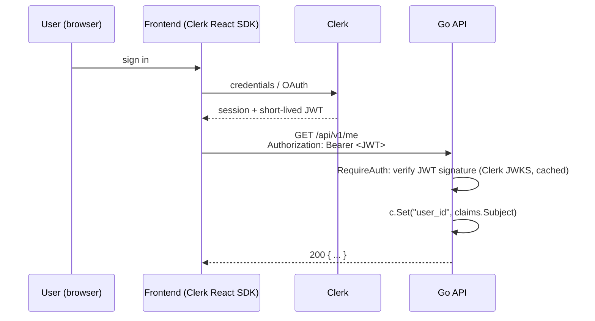

# 16 · Authentication with Clerk

## Authentication vs authorisation

- **Authentication (authN)**: *who are you?* Proving identity (login, token).
- **Authorisation (authZ)**: *what are you allowed to do?* Roles, permissions,
  ownership.

This backend **outsources authentication** to [Clerk](https://clerk.com) and
keeps **authorisation** in your services.

## Why outsource authN?

Building login well is hard: password hashing, email verification, MFA,
social login, session revocation, brute-force protection, account recovery.
A provider (Clerk, Auth0, Supabase Auth, Cognito, Firebase Auth) does this, and
your backend only has to **verify a signed token**.

## The flow



## The code

1. **`service/auth.go`**: `clerk.SetKey(cfg.Auth.SecretKey)` once at startup.
2. **`middleware/auth.go`**: `RequireAuth` wraps Clerk's
   `clerkhttp.WithHeaderAuthorization`, which:
   - reads `Authorization: Bearer <token>`,
   - verifies signature and expiry against Clerk's public keys (JWKS),
   - on failure → custom 401 JSON (`{"code":"UNAUTHORIZED",...}`),
   - on success → puts session claims into the request context.
3. Then our code copies claims into Echo's context:

| Key | Value |
|-----|-------|
| `user_id` | `claims.Subject` (Clerk user id, e.g. `user_2abc…`) |
| `user_role` | `claims.ActiveOrganizationRole` (e.g. `org:admin`) |
| `permissions` | `claims.Claims.ActiveOrganizationPermissions` |

## Using it

```go
// router
api := router.Group("/api/v1", middlewares.Auth.RequireAuth)

// handler
userID := middleware.GetUserID(c)
```

## Authorisation patterns (you write these)

**Ownership**: in the service and in SQL:

```sql
UPDATE todos SET completed = true WHERE id = $1 AND user_id = $2
```

If `RowsAffected() == 0`, return 404 (not 403), so you don't reveal that the id exists.

**Role check middleware:**

```go
func RequireRole(role string) echo.MiddlewareFunc {
    return func(next echo.HandlerFunc) echo.HandlerFunc {
        return func(c echo.Context) error {
            if r, _ := c.Get("user_role").(string); r != role {
                return errs.NewForbiddenError("Insufficient permissions", false)
            }
            return next(c)
        }
    }
}
admin := api.Group("/admin", RequireRole("org:admin"))
```

## Storing users locally

Clerk owns identities, but you'll usually want a `users` table for app data
(plan, preferences). Keep it in sync with **Clerk webhooks** (`user.created`,
`user.updated`, `user.deleted`), and verify the webhook signature.

## Security notes

- The secret key (`sk_…`) is **server-only**. The frontend uses the
  publishable key (`pk_…`).
- JWTs are short-lived; the frontend SDK refreshes them.
- Always use HTTPS so tokens can't be sniffed.

---

Next: [17 · Security](17-security.md)
