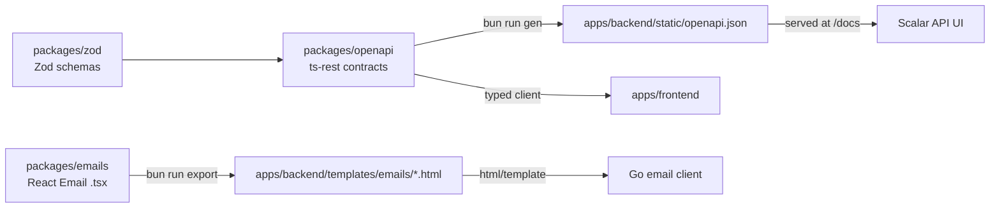

# 24 · How the monorepo fits together

```
go-boilerplate/
├── apps/
│   ├── backend/          Go API (this guide)
│   └── frontend/         React + Vite app
├── packages/
│   ├── zod/              shared Zod schemas (request/response shapes)
│   ├── openapi/          ts-rest contracts → generates openapi.json
│   └── emails/           React Email templates → export HTML to backend
├── package.json          Bun workspaces: apps/*, packages/*
└── turbo.json            Turborepo task pipeline (build, dev, lint, typecheck)
```

## Why a monorepo?

- **One pull request** can change the API contract, backend handler and
  frontend call together.
- **Shared types**: frontend and docs use the same schema source.
- **One place** for CI, tooling and conventions.

## The flows between packages



| Package | Produces | Consumed by |
|---------|----------|-------------|
| `@boilerplate/zod` | runtime schemas + TS types | openapi, frontend |
| `@boilerplate/openapi` | `apiContract` (ts-rest) + `openapi.json` | frontend (typed client), backend `/docs` |
| `@boilerplate/emails` | static HTML templates | backend `lib/email` |

## Important: Go does not read the TypeScript

The **Go structs are written by hand** and must match the contracts. The
contract is the agreement, and both sides implement it. To keep them honest:

- review contract + Go changes together in one PR,
- write a handler test that checks the JSON shape,
- or generate Go types from `openapi.json` (e.g. `oapi-codegen`) if drift
  becomes a problem.

## Turborepo

`turbo.json` defines tasks like `build`, `dev`, `lint`, `typecheck`.
`"dependsOn": ["^build"]` means "build my dependencies first", so `zod` builds
before `openapi`, which builds before `frontend`. Turbo caches results so
unchanged packages are skipped.

```bash
bun install      # once, at repo root
bun dev          # runs all "dev" tasks in parallel (frontend, package watchers…)
```

The Go backend is run separately with `task run` in `apps/backend`.
